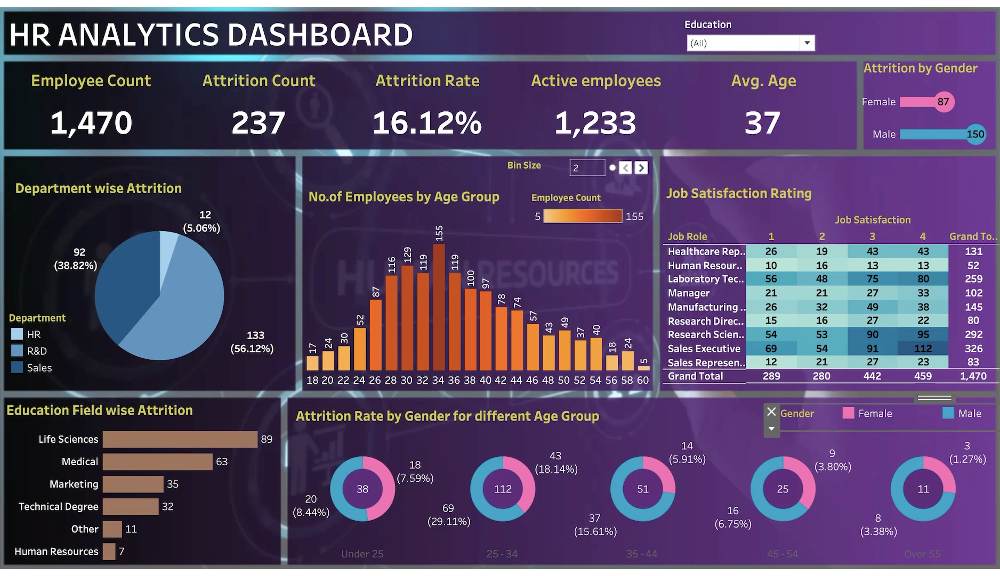

# 📊 HR Analytics & Employee Attrition Dashboard

## Overview
This interactive Tableau dashboard provides an in-depth analysis of organization workforce dynamics and employee attrition metrics. It enables HR teams and stakeholders to evaluate attrition rates across departments, age groups, education fields, and job satisfaction levels to design data-driven retention strategies.

---

## 📈 Key Dashboard Metrics & Insights

### Core KPIs
* **Total Employees:** 1,470
* **Total Attrition:** 237 employees
* **Overall Attrition Rate:** 16.12%
* **Active Workforce:** 1,233 employees
* **Average Employee Age:** 37 years

### Visual Breakdowns
1. **Department-Wise Attrition:**
   * **R&D:** Accounts for the majority of attrition at **56.12% (133 employees)**.
   * **Sales:** Comprises **38.82% (92 employees)**.
   * **HR:** Accounts for **5.06% (12 employees)**.

2. **Education Field-Wise Attrition:**
   * Highest attrition is observed in **Life Sciences (89)** and **Medical (63)** backgrounds, followed by **Marketing (35)** and **Technical Degrees (32)**.

3. **Demographics & Gender Insights:**
   * **Overall Attrition by Gender:** Male workforce sees higher overall attrition (**150**) compared to Female (**87**).
   * **Age & Gender Breakdown:** Peak attrition occurs in the **25–34 age group** (accounting for 29.11% Male and 18.14% Female attrition).

4. **Job Satisfaction Matrix:**
   * Detailed breakdown evaluating job roles against satisfaction scores (1 to 4) across healthcare, sales, management, and research positions to pinpoint turnover drivers.

---

## 🖼️ Dashboard Preview

---

## 🔗 Live Interactive Dashboard
👉 [Download / Open HR.twbx Workbook](./HR.twbx)

---

## 🛠️ Tools & Visualizations Used
* **BI Tool:** Tableau Desktop / Tableau Public
* **Chart Types Used:** KPI Cards, Donut Charts, Horizontal Bar Charts, Histograms, Matrix Heatmap Grid, and Ring Charts.
* **Interactivity:** Department/Education/Gender Filters, Binned Age Groups, dynamic parameters.
